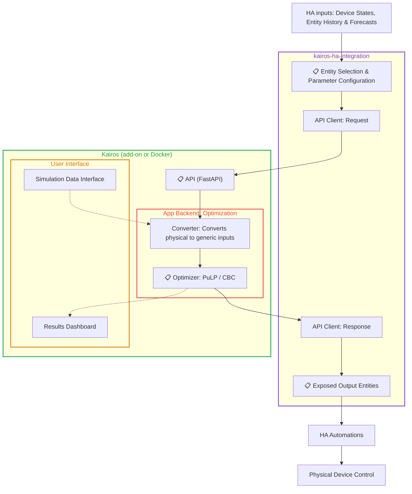

# Data Flow Architecture for Kairos
###  Easy, optimized energy scheduling for Home Assistant

> **Status:** Final.
> 
> **To Do:**
> - None

This document describes the data flow architecture for Kairos, defining how data moves through the application, from input and setup by the user in the Home Assistant integration to the resulting energy schedules and exposed entities.

There are some conversions happening during this data flow, to map these conversions the inputs at several stages of the architecture are defined below. Those stages are:
- [Entity Selection & Parameter Configuration](#-entity-selection--parameter-configuration-inputs)
- [API Inputs](#-api-inputs)
- [Optimizer Inputs](#-optimizer-inputs)
- [Exposed Output Entities](#-exposed-output-entities)

## Input Data Definitions

### 📋 Entity Selection & Parameter Configuration Inputs

Integration Parameters

| Name | Unit | Type | Description |
|---|---|---|---|
| Run optimization | - | Entity created by Kairos (config) | Button to trigger the optimization manually. |
| Kairos API URL | - | Parameter | Base URL of the Kairos API including the port, for example http://192.168.1.50:8000. |
| Schedule Time Step | min | Parameter | Length of each schedule slot, from 1 to 1440 minutes. Default 15. |
| Optimize Every N Time Steps | - | Parameter | Run the optimization at every Nth time step, from 1 to 1440. 1 runs it at every time step. Default 1. |
| Planning Horizon | h | Parameter | How far ahead the schedule is planned, from 1 to 168 hours. Default 24. |
| Request Timeout | s | Parameter | Max wait for one API response, from 1 to 3600 seconds. Must be longer than the solver time limit and shorter than the time step. Default 60. |
| Failures Before Repair Issue | - | Parameter | Failed optimization runs before a repair issue is shown in Home Assistant, from 1 to 20. Default 3. |
| Solver Time Limit | s | Parameter | Max solver run time per optimization, from 1 to 3600 seconds. Default 10. |
| Relative MIP Gap | 0-1 | Parameter | Stop once the best schedule is within this relative gap of the best bound, from 0 to 1. Set to 0 to require the solver to prove optimality. Default 0. |
| Storage Switching Penalty | cost per mode change | Parameter | Softly discourages storage mode changes between time steps. Set to 0 to allow switching freely. Default 0.1. |
| Grid Peak Penalty | relative weight | Parameter | Dimensionless weight. At 0.40 currency/kWh with 15-minute steps, 0.1 means the optimizer can accept up to 1 cent higher energy cost for a 1 kW lower grid peak. Set to 0 to disable. Default 0.1. |

Grid

| Name | Unit | Type | Description |
|---|---|---|---|
| Grid Import Price Forecast | currency/kWh | Entity | |
| Grid Import Price Forecast Attribute | currency/kWh | Parameter | |
| Grid Export Price Forecast | currency/kWh | Entity | |
| Grid Export Price Forecast Attribute | currency/kWh | Parameter | |
| Max Grid Import Power | W | Parameter | |
| Max Grid Export Power | W | Parameter | |

Solar

| Name | Unit | Type | Description |
|---|---|---|---|
| Solar Enabled | - | Entity created by Kairos (config) | Indicates whether the solar production is enabled. True if enabled, false otherwise. |
| Solar Production Power Forecast | W | Entity | |
| Solar Production Power Forecast Attribute | W | Parameter | |

Base Load

| Name | Unit | Type | Description |
|---|---|---|---|
| Base Load Power (+/- Sensor) | W | Entity | The household's electrical power draw excluding every device modelled in Kairos (e.g. Home Battery and EV Battery charging, DHW Tank and Building Thermal Mass heat pumps, Controllable Loads). |

Controllable Loads

| Name | Unit | Type | Description |
|---|---|---|---|
| Controllable Load Enabled | - | Entity created by Kairos (config) | Indicates whether the controllable load is enabled. True if enabled, false otherwise. |
| Run Start Time | timestamp | Entity created by Kairos (config) | An automatically created timestamp sensor. Your automation should set it to the time the device was last turned on. |
| Earliest Start Time | HH:MM | Entity created by Kairos (config) | Time of day when the controllable load can start operating. |
| Latest Finish Time | HH:MM | Entity created by Kairos (config) | Time of day by which the controllable load must finish operating. |
| Average Power | W | Parameter | |
| Runtime | h | Parameter | |

Home Battery

| Name | Unit | Type | Description |
|---|---|---|---|
| Home Battery Enabled | - | Entity created by Kairos (config) | Indicates whether the Home Battery is enabled. True if enabled, false otherwise. |
| Current State of Charge | 0-1 | Entity | |
| Energy Capacity | Wh | Parameter | |
| Min State of Charge | 0-1 | Parameter | |
| Max State of Charge | 0-1 | Parameter | |
| Max Charge Power | W | Parameter | |
| Max Discharge Power | W | Parameter | |
| Charge Efficiency | 0-1 | Parameter | |
| Discharge Efficiency | 0-1 | Parameter | |
| Passive Discharge Power | W | Parameter | |

EV Battery

| Name | Unit | Type | Description |
|---|---|---|---|
| EV Battery Enabled | - | Entity created by Kairos (config) | Indicates whether the EV Battery is enabled. True if enabled, false otherwise. |
| Current State of Charge | 0-1 | Entity | |
| Energy Capacity | Wh | Parameter | |
| Min State of Charge | 0-1 | Parameter | |
| Max State of Charge | 0-1 | Parameter | |
| Max Charge Power | W | Parameter | |
| Max Discharge Power | W | Parameter | |
| Charge Efficiency | 0-1 | Parameter | |
| Discharge Efficiency | 0-1 | Parameter | |
| Passive Discharge Power | W | Parameter | |
| Vehicle Efficiency | km/kWh | Parameter | |
| Round-Trip Distance | km | Entity created by Kairos (config) | An automatically created entity representing the expected round-trip distance of the EV. |
| Expected Departure Time | - | Entity created by Kairos (config) | An automatically created entity representing the expected departure time of the EV. |
| Expected Arrival Time | - | Entity created by Kairos (config) | An automatically created entity representing the expected arrival time of the EV. |

DHW Tank

| Name | Unit | Type | Description |
|---|---|---|---|
| DHW Tank Enabled | - | Entity created by Kairos (config) | Indicates whether the DHW Tank is enabled. True if enabled, false otherwise. |
| Current Water Temperature | °C | Entity | |
| Tank Volume | L | Parameter | |
| Min Water Temperature | °C | Parameter | Set to the ambient temperature around the tank. Sets the bottom of the state of charge scale and, together with the Max Water Temperature, the range used for passive discharge power. |
| Max Water Temperature | °C | Parameter | |
| Min Comfort Temperature | °C | Parameter | |
| Heat Loss Coefficient | W/°C | Parameter | |
| Heat Pump Electric Power | W | Parameter | |
| Heat Pump Coefficient of Performance (COP) | - | Parameter | |
| Morning Peak Energy Demand | Wh | Parameter | |
| Evening Peak Energy Demand | Wh | Parameter | |
| Morning Demand Peak Time | - | Parameter | |
| Evening Demand Peak Time | - | Parameter | |

Building Thermal Mass

| Name | Unit | Type | Description |
|---|---|---|---|
| Building Thermal Mass Enabled | - | Entity created by Kairos (config) | Indicates whether the Building Thermal Mass is enabled. True if enabled, false otherwise. |
| Indoor Temperature | °C | Entity | Indoor temperature value and history. Used to calculate Heat Loss Coefficient and the average indoor temperature is used to derive COP as function of outdoor temperature. |
| Outdoor Temperature | °C | Entity | Outdoor temperature history. Used to calculate Heat Loss Coefficient and to derive COP as function of outdoor temperature. |
| Outdoor Temperature Forecast Attribute | °C | Parameter | Attribute of outdoor temperature sensor that contains the forecast. Used to calculate passive discharge power forecast by multiplying temperature difference with heat loss coefficient. |
| Electric Power | W | Entity | Heat pump electric power history. Used with Thermal Power and outdoor temperature to derive COP as function of outdoor temperature. |
| Thermal Power | W | Entity | Heat pump thermal output history. Used to calculate Heat Loss Coefficient and to derive COP as function of outdoor temperature. |
| Min Room Temperature | °C | Parameter | Physical room temperature that corresponds to 0% state of charge. |
| Max Room Temperature | °C | Parameter | Physical room temperature that corresponds to 100% state of charge. |
| Min Comfort Temperature | °C | Parameter | Soft lower comfort bound. Dropping below it incurs a penalty. It should be set low enough below the normal indoor temperature to allow for some variation in temperature during normal heat pump operation. |
| Max Comfort Temperature | °C | Parameter | Soft upper comfort bound. Exceeding it incurs a penalty. It should be set high enough above the normal indoor temperature to allow for some variation in temperature during normal heat pump operation. |
| Heat Loss Coefficient | W/°C | Parameter | This is already calculated from historic indoor temperature, outdoor temperature and thermal power. If this is non-zero it will override the calculated value. Used to derive the Passive Discharge Power. |
| Floor Area | m² | Parameter | |
| Thermal Mass Coefficient | Wh/m²/°C | Parameter | Heat storage capacity of the building per m² of floor area. This does not need be an exact number, the default is generally fine. |
| Heating Rate (+dT) | °C/h | Parameter | Indoor temperature rise per hour in +dT (charge) mode. Empirically determined. Used with Floor Area and Thermal Mass Coefficient to calculate the charge power. |
| +dT Flow Temperature Offset | °C | Parameter | Flow temperature offset on the weather compensation curve in +dT mode. |
| Cooldown Rate (-dT) | °C/h | Parameter | Indoor temperature change per hour in -dT (discharge) mode, entered as a negative value. Empirically determined. Used with Floor Area and Thermal Mass Coefficient to calculate the discharge power. |
| -dT Flow Temperature Offset | °C | Parameter | Flow temperature offset on the weather compensation curve in -dT mode. |
| COP Flow Temperature Sensitivity | -/°C | Parameter | Fractional change in COP per °C of flow temperature offset, e.g. -0.02 = -2%/°C. |

### 📋 API Inputs

Request

| Name | Unit | Type | Description |
|---|---|---|---|
| Timestamp | timestamp | Request field | Start of the planning horizon. Forecasts are aligned to the time step grid from this time. |
| Time Step Duration | h | Request field | Converted from Schedule Time Step (min) to hours. |
| Planning Horizon | h | Request field | ✅ Passed 1:1. |
| Solver Time Limit | s | Request field | ✅ Passed 1:1. |
| Relative MIP Gap | 0-1 | Request field | ✅ Passed 1:1. |
| Storage Switching Penalty | cost per mode change | Request field | ✅ Passed 1:1. |
| Grid Peak Penalty | relative weight | Request field | ✅ Passed 1:1. |

Grid

| Name | Unit | Type | Description |
|---|---|---|---|
| Grid Import Price Forecast | price/Wh | Request field | Forecast list with one value per time step, taken from the Grid Import Price Forecast Attribute. |
| Grid Export Price Forecast | price/Wh | Request field | Forecast list with one value per time step, taken from the Grid Export Price Forecast Attribute. |
| Max Grid Import Power | W | Request field | ✅ Passed 1:1. |
| Max Grid Export Power | W | Request field | ✅ Passed 1:1. |

Solar

| Name | Unit | Type | Description |
|---|---|---|---|
| Power Forecast | W | Request field | Forecast list with one value per time step, taken from the Solar Production Power Forecast Attribute. |

Base Load

| Name | Unit | Type | Description |
|---|---|---|---|
| Power Forecast | W | Request field | Forecast list with one value per time step, built from Base Load Power (+/- Sensor). |

Controllable Loads

| Name | Unit | Type | Description |
|---|---|---|---|
| Run Start Time | timestamp | Request field | ✅ Passed 1:1. Optional. Marks a run already in progress. |
| Earliest Start Time | HH:MM | Request field | ✅ Passed 1:1. |
| Latest Finish Time | HH:MM | Request field | ✅ Passed 1:1. |
| Average Power | W | Request field | ✅ Passed 1:1. |
| Energy Demand | Wh | Request field | Converted from Average Power multiplied by Runtime (h). |

Home Battery

| Name | Unit | Type | Description |
|---|---|---|---|
| Storage Type | - | Request field | Set to `home_battery`. |
| Current State of Charge | 0-1 | Request field | ✅ Passed 1:1. |
| Energy Capacity | Wh | Request field | ✅ Passed 1:1. |
| Min State of Charge | 0-1 | Request field | ✅ Passed 1:1. |
| Max State of Charge | 0-1 | Request field | ✅ Passed 1:1. |
| Max Charge Power | W | Request field | ✅ Passed 1:1. |
| Max Discharge Power | W | Request field | ✅ Passed 1:1. |
| Charge Efficiency | 0-1 | Request field | ✅ Passed 1:1. |
| Discharge Efficiency | 0-1 | Request field | ✅ Passed 1:1. |
| Passive Discharge Power | W | Request field | ✅ Passed 1:1. Defaults to 0 if not given. |

EV Battery

| Name | Unit | Type | Description |
|---|---|---|---|
| Storage Type | - | Request field | Set to `ev_battery`. |
| Current State of Charge | 0-1 | Request field | ✅ Passed 1:1. |
| Energy Capacity | Wh | Request field | ✅ Passed 1:1. |
| Min State of Charge | 0-1 | Request field | ✅ Passed 1:1. |
| Max State of Charge | 0-1 | Request field | ✅ Passed 1:1. |
| Max Charge Power | W | Request field | ✅ Passed 1:1. |
| Max Discharge Power | W | Request field | ✅ Passed 1:1. |
| Charge Efficiency | 0-1 | Request field | ✅ Passed 1:1. |
| Discharge Efficiency | 0-1 | Request field | ✅ Passed 1:1. |
| Passive Discharge Power | W | Request field | ✅ Passed 1:1. Defaults to 0 if not given. |
| Vehicle Efficiency | km/Wh | Request field | Converted from Vehicle Efficiency (km/kWh) by dividing by 1000. |
| Round-Trip Distance | km | Request field | ✅ Passed 1:1. |
| Expected Departure Time | timestamp | Request field | Converted from Expected Departure Time: combined with the start date and sent as an ISO timestamp. |
| Expected Arrival Time | timestamp | Request field | Converted from Expected Arrival Time: combined with the start date and sent as an ISO timestamp. |

DHW Tank

| Name | Unit | Type | Description |
|---|---|---|---|
| Storage Type | - | Request field | Set to `dhw_tank`. |
| Current Water Temperature | °C | Request field | ✅ Passed 1:1. |
| Tank Volume | L | Request field | ✅ Passed 1:1. |
| Min Water Temperature | °C | Request field | ✅ Passed 1:1. Set to the ambient temperature around the tank. |
| Max Water Temperature | °C | Request field | ✅ Passed 1:1. |
| Min Comfort Temperature | °C | Request field | ✅ Passed 1:1. |
| Heat Loss Coefficient | W/°C | Request field | ✅ Passed 1:1. |
| Heat Pump Electric Power | W | Request field | ✅ Passed 1:1. |
| Heat Pump Coefficient of Performance (COP) | - | Request field | ✅ Passed 1:1. |
| Morning Peak Energy Demand | Wh | Request field | ✅ Passed 1:1. |
| Evening Peak Energy Demand | Wh | Request field | ✅ Passed 1:1. |
| Morning Demand Peak Time | HH:MM | Request field | ✅ Passed 1:1. |
| Evening Demand Peak Time | HH:MM | Request field | ✅ Passed 1:1. |

Building Thermal Mass

| Name | Unit | Type | Description |
|---|---|---|---|
| Storage Type | - | Request field | Set to `building_thermal_mass`. |
| Indoor Temperature | °C | Request field | ✅ Passed 1:1. |
| Outdoor Temperature Forecast | °C | Request field | Forecast list with one value per time step, taken from the Outdoor Temperature Forecast Attribute. |
| Min Room Temperature | °C | Request field | ✅ Passed 1:1. |
| Max Room Temperature | °C | Request field | ✅ Passed 1:1. |
| Min Comfort Temperature | °C | Request field | ✅ Passed 1:1. |
| Max Comfort Temperature | °C | Request field | ✅ Passed 1:1. |
| Heat Loss Coefficient | W/°C | Request field | Calculated based on historic indoor temperature, outdoor temperature and thermal power data. If heat loss coefficient is nonzero it is ✅ Passed 1:1. |
| Floor Area | m² | Request field | ✅ Passed 1:1. |
| Thermal Mass Coefficient | Wh/m²/°C | Request field | ✅ Passed 1:1. |
| Heating Rate (+dT) | °C/h | Request field | ✅ Passed 1:1. |
| +dT Flow Temperature Offset | °C | Request field | ✅ Passed 1:1. |
| Cooldown Rate (-dT) | °C/h | Request field | ✅ Passed 1:1. |
| -dT Flow Temperature Offset | °C | Request field | ✅ Passed 1:1. |
| Reference COP | - | Request field | Calculated by the integration from indoor temperature, outdoor temperature, electric power and thermal power history, then passed to the API. |
| Reference Outdoor Temperature | °C | Request field | Calculated by the integration from history, then passed to the API. |
| COP Outdoor Temperature Coefficient | COP/°C | Request field | Calculated by the integration from history, then passed to the API. |
| COP Flow Temperature Sensitivity | -/°C | Request field | ✅ Passed 1:1. |

### 📋 Optimizer Inputs

Solver Settings

| Name | Unit | Type | Description |
|---|---|---|---|
| Time Step Duration | h | Solver setting | ✅ Passed 1:1. |
| Planning Horizon | h | Solver setting | ✅ Passed 1:1. Number of steps is Planning Horizon ÷ Time Step Duration. |
| Solver Time Limit | s | Solver setting | ✅ Passed 1:1. Passed to CBC as the time limit. |
| Relative MIP Gap | 0-1 | Solver setting | ✅ Passed 1:1. Passed to CBC as the relative gap. |
| Storage Switching Penalty | cost per mode change | Solver setting | ✅ Passed 1:1. |
| Grid Peak Penalty | relative weight | Solver setting | ✅ Passed 1:1. |

Grid

| Name | Unit | Type | Description |
|---|---|---|---|
| Grid Import Price Forecast | price/Wh per time step | Object attribute | ✅ Passed 1:1. |
| Grid Export Price Forecast | price/Wh per time step | Object attribute | ✅ Passed 1:1. |
| Max Grid Import Power | W | Object attribute | ✅ Passed 1:1. |
| Max Grid Export Power | W | Object attribute | ✅ Passed 1:1. |

Solar

| Name | Unit | Type | Description |
|---|---|---|---|
| Power Forecast | W per time step | Object attribute | ✅ Passed 1:1. |

Base Load

| Name | Unit | Type | Description |
|---|---|---|---|
| Controllable | - | Object attribute | Fixed per class: `no`. |
| Power Forecast | W per time step | Object attribute | ✅ Passed 1:1. |

Controllable Loads

| Name | Unit | Type | Description |
|---|---|---|---|
| Controllable | - | Object attribute | Fixed per class: `yes`. |
| Average Power | W | Object attribute | ✅ Passed 1:1. |
| Energy Demand | Wh | Object attribute | ✅ Passed 1:1. |
| Run Start Time | timestamp | Object attribute | ✅ Passed 1:1. Optional. Marks a run already in progress. |
| Earliest Start Time | timestamp | Object attribute | Converted from Earliest Start Time (HH:MM): the next daily window that is open at or after the planning start. |
| Latest Finish Time | timestamp | Object attribute | Converted from Latest Finish Time (HH:MM): end of the same window as Earliest Start Time. |

Home Battery

| Name | Unit | Type | Description |
|---|---|---|---|
| Storage Class | - | Object class | Set to `Battery`. |
| Current State of Charge | 0-1 | Object attribute | ✅ Passed 1:1. |
| Energy Capacity | Wh | Object attribute | ✅ Passed 1:1. |
| Max State of Charge | 0-1 | Object attribute | ✅ Passed 1:1. |
| Min State of Charge | 0-1 | Object attribute | ✅ Passed 1:1. |
| Charge Efficiency | 0-1 | Object attribute | ✅ Passed 1:1. |
| Discharge Efficiency | 0-1 | Object attribute | ✅ Passed 1:1. |
| Passive Discharge Power | W | Object attribute | ✅ Passed 1:1. Defaults to 0 if not given. |
| Discharge to Electrical Network | - | Object attribute | Fixed per class: `yes`. |
| Energy Demand Forecast | Wh per time step | Object attribute | Zero for every time step. |
| Availability Window | 1/0 per time step | Object attribute | Always 1. |
| Max Charge Power | W | Object attribute | ✅ Passed 1:1. |
| Max Discharge Power | W | Object attribute | ✅ Passed 1:1. |

EV Battery

| Name | Unit | Type | Description |
|---|---|---|---|
| Storage Class | - | Object class | Set to `Battery`. |
| Current State of Charge | 0-1 | Object attribute | ✅ Passed 1:1. |
| Energy Capacity | Wh | Object attribute | ✅ Passed 1:1. |
| Max State of Charge | 0-1 | Object attribute | ✅ Passed 1:1. |
| Min State of Charge | 0-1 | Object attribute | ✅ Passed 1:1. |
| Charge Efficiency | 0-1 | Object attribute | ✅ Passed 1:1. |
| Discharge Efficiency | 0-1 | Object attribute | ✅ Passed 1:1. |
| Passive Discharge Power | W | Object attribute | ✅ Passed 1:1. Defaults to 0 if not given. |
| Discharge to Electrical Network | - | Object attribute | Fixed per class: `yes`. |
| Energy Demand Forecast | Wh per time step | Object attribute | Trip energy (Round-Trip Distance ÷ Vehicle Efficiency) placed at each daily Expected Departure Time. |
| Availability Window | 1/0 per time step | Object attribute | 0 from each Expected Departure Time until the Expected Arrival Time, 1 otherwise. |
| Max Charge Power | W | Object attribute | ✅ Passed 1:1. |
| Max Discharge Power | W | Object attribute | ✅ Passed 1:1. |

DHW Tank

| Name | Unit | Type | Description |
|---|---|---|---|
| Storage Class | - | Object class | Set to `DHW`. |
| Current State of Charge | 0-1 | Object attribute | Converted from Current Water Temperature: (temperature − Min Water Temperature) ÷ (Max − Min Water Temperature). |
| Energy Capacity | Wh | Object attribute | Converted from Tank Volume: volume × water specific heat × (Max − Min Water Temperature). |
| Max State of Charge | 0-1 | Object attribute | Fixed at 1 (up to Max Water Temperature). |
| Min State of Charge | 0-1 | Object attribute | Converted from Min Comfort Temperature, on the same scale as Current State of Charge. |
| Charge Efficiency | - | Object attribute | ✅ Passed 1:1 from Heat Pump Coefficient of Performance (COP). |
| Discharge Efficiency | - | Object attribute | Fixed at 1. |
| Passive Discharge Power | W | Object attribute | Converted from Heat Loss Coefficient × (Max − Min Water Temperature). |
| Discharge to Electrical Network | - | Object attribute | Fixed per class: `no`. |
| Energy Demand Forecast | Wh per time step | Object attribute | Built from Morning Peak Energy Demand and Evening Peak Energy Demand, placed at the daily Morning and Evening Demand Peak Times. |
| Availability Window | 1/0 per time step | Object attribute | Always 1. |
| Charge Power | W | Object attribute | ✅ Passed 1:1 from Heat Pump Electric Power. Discrete, not a max. |

Building Thermal Mass

| Name | Unit | Type | Description |
|---|---|---|---|
| Storage Class | - | Object class | Set to `BTM`. |
| Current State of Charge | 0-1 | Object attribute | Converted from Indoor Temperature: (temperature − Min Room Temperature) ÷ (Max − Min Room Temperature). |
| Energy Capacity | Wh | Object attribute | Converted from Floor Area and Thermal Mass Coefficient: Floor Area × Thermal Mass Coefficient × (Max − Min Room Temperature). |
| Max State of Charge | 0-1 | Object attribute | Converted from Max Comfort Temperature, on the same scale as Current State of Charge. |
| Min State of Charge | 0-1 | Object attribute | Converted from Min Comfort Temperature, on the same scale as Current State of Charge. |
| Charge Efficiency | - | Object attribute | Set to 0. The COP Forecast is used instead. |
| Discharge Efficiency | - | Object attribute | Fixed at 1. |
| Passive Discharge Power | W per time step | Object attribute | Heat loss per time step: Heat Loss Coefficient × (Current Indoor Temperature − Outdoor Temperature Forecast). |
| Discharge to Electrical Network | - | Object attribute | Fixed per class: `no`. |
| Energy Demand Forecast | Wh per time step | Object attribute | Zero for every time step. |
| Availability Window | 1/0 per time step | Object attribute | Always 1. |
| Charge Power | W | Object attribute | Discrete thermal power in +dT mode: Floor Area × Thermal Mass Coefficient × Heating Rate (+dT). |
| Discharge Power | W | Object attribute | Discrete thermal power in -dT mode, stored as a positive magnitude: −(Floor Area × Thermal Mass Coefficient × Cooldown Rate (-dT)). |
| COP Forecast | - | Object attribute | Per time step, default curve: Reference COP + COP Outdoor Temperature Coefficient × (Outdoor Temperature Forecast − Reference Outdoor Temperature). |
| +dT Flow Temperature Offset | °C | Object attribute | ✅ Passed 1:1. |
| -dT Flow Temperature Offset | °C | Object attribute | ✅ Passed 1:1. |
| COP Flow Temperature Sensitivity | -/°C | Object attribute | ✅ Passed 1:1. |

### 📋 Exposed Output Entities

Per asset

| Name | Unit | Type | Description |
|---|---|---|---|
| Power Setpoint | W | Entity created by Kairos | Setpoint for the current time step. Storage: positive is charge, negative is discharge. Building Thermal Mass: the full heat pump electrical power in each mode, so it is never negative. Loads: zero or positive. Becomes `unavailable` when the schedule runs out. Has `Forecast` attribute that contains the full scheduled forecast (time and value pairs) for the planning horizon. Created for Grid, Controllable Load, Home Battery, EV Battery, DHW Tank and Building Thermal Mass. |
| Mode | - | Entity created by Kairos | Building Thermal Mass only. `charge` (+dT), `neutral` (0) or `discharge` (-dT). Use this rather than the setpoint to control the heat pump. |

Diagnostic

| Name | Unit | Type | Description |
|---|---|---|---|
| Objective Cost | - | Entity created by Kairos (diagnostic) | Objective cost of the latest successful optimization. Attribute: optimization ID. |
| Last Optimization Attempt | - | Entity created by Kairos (diagnostic) | Result of the latest API call: `HTTP <code>`, `API <status>`, `Request error` or `No response`. Attributes: HTTP status, API request, API response, error. |

Optimizer forecasts

Each entity holds the forecast the optimizer used, in the same unit, as a `Forecast` attribute with time and value pairs for the planning horizon (same as Power Setpoint). Only created for the assets listed.

| Name | Unit | Type | Description |
|---|---|---|---|
| Grid Import Price Forecast | price/kWh | Entity created by Kairos (forecast) | Import price per time step. Created for Grid. |
| Grid Export Price Forecast | price/kWh | Entity created by Kairos (forecast) | Export price per time step. Created for Grid. |
| Solar Production Power Forecast | W | Entity created by Kairos (forecast) | Solar production per time step. Created for Solar when Solar Enabled is true. |
| Base Load Power Forecast | W | Entity created by Kairos (forecast) | Base load per time step, built from Base Load Power (+/- Sensor). Created for Base Load. |
| Energy Demand Forecast | Wh per time step | Entity created by Kairos (forecast) | Useful energy demand per time step. Created for every storage asset. |
| Passive Discharge Power Forecast | W per time step | Entity created by Kairos (forecast) | Passive discharge per time step. Created for every storage asset. |
| COP Forecast | - | Entity created by Kairos (forecast) | Heat pump COP per time step in default curve mode. Created for Building Thermal Mass. |

