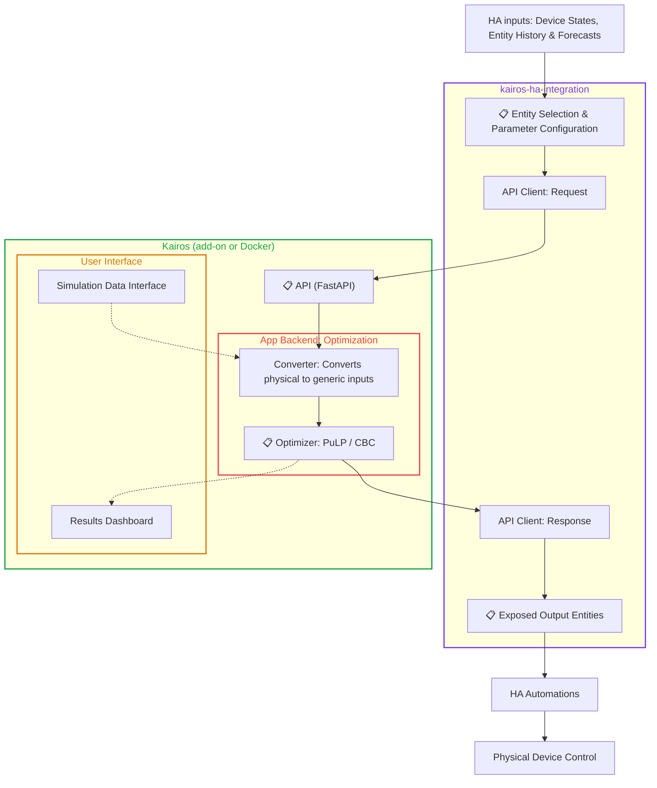

# Data Flow Architecture for Kairos
###  Easy, optimized energy scheduling for Home Assistant

This document describes the data flow architecture for Kairos, defining how data moves through the application, from input and setup by the user in the Home Assistant integration to the resulting energy schedules and exposed entities.

There are some conversions happening during this data flow, to map these conversions the inputs at several stages of the architecture are defined below. Those stages are:
- [Entity Selection & Parameter Configuration](#-entity-selection--parameter-configuration-inputs)
- [API Inputs](#-api-inputs)
- [Optimizer Inputs](#-optimizer-inputs)
- [Exposed Output Entities](#-exposed-output-entities)

## Input Data Definitions
### 📋 Entity Selection & Parameter Configuration Inputs

Integration parameters

| Name | Unit | Type | Description |
|---|---|---|---|
| Run optimization | - | Entity created by Kairos (config) | Button to trigger the optimization manually. |
| Kairos API URL | - | Parameter | Base URL of the Kairos API including the port, for example http://192.168.1.50:8000. |
| Schedule time step | min | Parameter | Length of each schedule slot, from 1 to 1440 minutes. Default 15. |
| Optimize every N time steps | - | Parameter | Run the optimization at every Nth time step, from 1 to 1440. 1 runs it at every time step. Default 1. |
| Planning horizon | h | Parameter | How far ahead the schedule is planned, from 1 to 168 hours. Default 24. |
| Request timeout | s | Parameter | Maximum wait for one API response, from 1 to 3601 seconds. Must be longer than the solver time limit and shorter than the time step. Default 60. |
| Failures before repair issue | - | Parameter | Failed optimization runs before a repair issue is shown in Home Assistant, from 1 to 20. Default 3. |
| Solver time limit | s | Parameter | Maximum solver run time per optimization, from 1 to 3600 seconds. Default 10. |
| Relative MIP gap | 0-1 | Parameter | Stop once the best schedule is within this relative gap of the best bound, from 0 to 1. Set to 0 to require the solver to prove optimality. Default 0. |
| Storage switching penalty | cost per mode change | Parameter | Softly discourages storage mode changes between time steps. Set to 0 to allow switching freely. Default 0.1. |
| Grid peak penalty | relative weight | Parameter | Dimensionless weight. At 0.40 currency/kWh with 15-minute steps, 0.1 means the optimizer can accept up to 1 cent higher energy cost for a 1 kW lower grid peak. Set to 0 to disable. Default 0.1. |

Grid

| Name | Unit | Type | Description |
|---|---|---|---|
| Grid import price forecast | currency/kWh | Entity | |
| Grid import price forecast attribute | currency/kWh | Parameter | |
| Grid export price forecast | currency/kWh | Entity | |
| Grid export price forecast attribute | currency/kWh | Parameter | |
| Maximum grid import power | W | Parameter | |
| Maximum grid export power | W | Parameter | |

Solar

| Name | Unit | Type | Description |
|---|---|---|---|
| Solar enabled | - | Entity created by Kairos (config) | Indicates whether the solar production is enabled. True if enabled, false otherwise. |
| Solar production power forecast | W | Entity | |
| Solar production power forecast attribute | W | Parameter | |

Base load

| Name | Unit | Type | Description |
|---|---|---|---|
| Base load power (+/- sensor) | W | Entity | The household's electrical power draw excluding every device modelled in Kairos (e.g. Home Battery and EV Battery charging, DHW Tank and Building Thermal Mass heat pumps, Controllable Loads). |

Controllable load

| Name | Unit | Type | Description |
|---|---|---|---|
| Controllable load enabled | - | Entity created by Kairos (config) | Indicates whether the controllable load is enabled. True if enabled, false otherwise. |
| Run start time | timestamp | Entity created by Kairos (config) | An automatically created timestamp sensor. Your automation should set it to the time the device was last turned on. |
| Earliest start time | - | Entity created by Kairos (config) | Time of day when the controllable load can start operating. |
| Latest finish time | - | Entity created by Kairos (config) | Time of day by which the controllable load must finish operating. |
| Average power | W | Parameter | |
| Runtime | h | Parameter | |

Home battery

| Name | Unit | Type | Description |
|---|---|---|---|
| Home battery enabled | - | Entity created by Kairos (config) | Indicates whether the home battery is enabled. True if enabled, false otherwise. |
| Current state of charge (SoC) | 0-1 | Entity | |
| Energy capacity | Wh | Parameter | |
| Minimum state of charge (SoC) | 0-1 | Parameter | |
| Maximum state of charge (SoC) | 0-1 | Parameter | |
| Maximum charge power | W | Parameter | |
| Maximum discharge power | W | Parameter | |
| Charge efficiency | 0-1 | Parameter | |
| Discharge efficiency | 0-1 | Parameter | |
| Passive discharge power | W | Parameter | |

EV battery

| Name | Unit | Type | Description |
|---|---|---|---|
| EV battery enabled | - | Entity created by Kairos (config) | Indicates whether the EV battery is enabled. True if enabled, false otherwise. |
| Current state of charge (SoC) | 0-1 | Entity | |
| Energy capacity | Wh | Parameter | |
| Minimum state of charge (SoC) | 0-1 | Parameter | |
| Maximum state of charge (SoC) | 0-1 | Parameter | |
| Maximum charge power | W | Parameter | |
| Maximum discharge power | W | Parameter | |
| Charge efficiency | 0-1 | Parameter | |
| Discharge efficiency | 0-1 | Parameter | |
| Passive discharge power | W | Parameter | |
| Vehicle efficiency | km/kWh | Parameter | |
| Round-trip distance | km | Entity created by Kairos (config) | An automatically created entity representing the expected round-trip distance of the EV. |
| Expected departure time | - | Entity created by Kairos (config) | An automatically created entity representing the expected departure time of the EV. |
| Expected arrival time | - | Entity created by Kairos (config) | An automatically created entity representing the expected arrival time of the EV. |

DHW tank

| Name | Unit | Type | Description |
|---|---|---|---|
| DHW tank enabled | - | Entity created by Kairos (config) | Indicates whether the DHW tank is enabled. True if enabled, false otherwise. |
| Current water temperature | °C | Entity | |
| Tank volume | L | Parameter | |
| Minimum water temperature | °C | Parameter | Set to the ambient temperature around the tank. Sets the bottom of the state of charge scale and, together with the maximum water temperature, the range used for passive discharge power. |
| Maximum water temperature | °C | Parameter | |
| Minimum comfort temperature | °C | Parameter | |
| Heat loss coefficient | W/°C | Parameter | |
| Heat pump electric power | W | Parameter | |
| Heat pump coefficient of performance (COP) | - | Parameter | |
| Morning peak energy demand | Wh | Parameter | |
| Evening peak energy demand | Wh | Parameter | |
| Morning demand peak time | - | Parameter | |
| Evening demand peak time | - | Parameter | |

Building thermal mass

| Name | Unit | Type | Description |
|---|---|---|---|
| Building thermal mass enabled | - | Entity created by Kairos (config) | Indicates whether the building thermal mass is enabled. True if enabled, false otherwise. |
| Indoor temperature | °C | Entity | Indoor temperature value and history. Used to calculate heat loss coefficient and the average indoor temperature is used to derive COP as function of outdoor temperature. |
| Outdoor temperature | °C | Entity | Outdoor temperature history. Used to calculate heat loss coefficient and to derive COP as function of outdoor temperature. |
| Outdoor temperature forecast attribute | °C | Parameter | Attribute of outdoor temperature sensor that contains the forecast. Used to calculate passive discharge power forecast by multiplying temperature difference with heat loss coefficient. | 
| Electric power | W | Entity | Heat pump electric power history. Used with thermal power and outdoor temperature to derive COP as function of outdoor temperature. |
| Thermal power | W | Entity | Heat pump thermal output history. Used to calculate heat loss coefficient and to derive COP as function of outdoor temperature. |
| Min room temperature | °C | Parameter | Physical room temperature that corresponds to 0% state of charge. |
| Max room temperature | °C | Parameter | Physical room temperature that corresponds to 100% state of charge. |
| Minimum comfort temperature | °C | Parameter | Soft lower comfort bound. Dropping below it incurs a penalty. It should be set low enough below the normal indoor temperature to allow for some variation in temperature during normal heat pump operation. |
| Maximum comfort temperature | °C | Parameter | Soft upper comfort bound. Exceeding it incurs a penalty. It should be set high enough above the normal indoor temperature to allow for some variation in temperature during normal heat pump operation. |
| Heat loss coefficient | W/°C | Parameter | This is already calculated from historic indoor temperature, outdoor temperature and thermal power. If this is non-zero it will override the calculated value. Used to derive the passive discharge power. |
| Floor area | m² | Parameter | |
| Thermal mass coefficient | Wh/m²/°C | Parameter | Heat storage capacity of the building per m² of floor area. This does not need be an exact number, the default is generally fine. |
| Heating rate (+dT) | °C/h | Parameter | Indoor temperature rise per hour in +dT (charge) mode. Empirically determined. Used with floor area and thermal mass coefficient to calculate the charge power. |
| +dT | °C | Parameter | Flow temperature offset on the weather compensation curve in +dT mode. |
| Cooldown rate (-dT) | °C/h | Parameter | Indoor temperature drop per hour in -dT (discharge) mode. Empirically determined. Used with floor area and thermal mass coefficient to calculate the discharge power. |
| -dT | °C | Parameter | Flow temperature offset on the weather compensation curve in -dT mode. |
| COP flow temperature sensitivity | -/°C | Parameter | Fractional change in COP per °C of flow temperature offset, e.g. -0.02 = -2%/°C. |

### 📋 API Inputs

Request

| Name | Unit | Type | Description |
|---|---|---|---|
| Timestamp | timestamp | Request field | Start of the planning horizon. Forecasts are aligned to the time step grid from this time. |
| Time step duration | h | Request field | Converted from Schedule time step (min) to hours. |
| Horizon | h | Request field | Passed 1:1 from Planning horizon. |
| Solver time limit | s | Request field | Passed 1:1 from Solver time limit. |
| Relative MIP gap | 0-1 | Request field | Passed 1:1 from Relative MIP gap. |
| Storage switching penalty | cost per mode change | Request field | Passed 1:1 from Storage switching penalty. |
| Grid peak penalty | relative weight | Request field | Passed 1:1 from Grid peak penalty. |

Grid

| Name | Unit | Type | Description |
|---|---|---|---|
| Grid import price forecast | currency/kWh | Request field | Forecast list with one value per time step, taken from the Grid import price forecast attribute. |
| Grid export price forecast | currency/kWh | Request field | Forecast list with one value per time step, taken from the Grid export price forecast attribute. |
| Maximum grid import power | W | Request field | Passed 1:1 from Maximum grid import power. |
| Maximum grid export power | W | Request field | Passed 1:1 from Maximum grid export power. |

Solar

| Name | Unit | Type | Description |
|---|---|---|---|
| Power forecast | W | Request field | Forecast list with one value per time step, taken from the Solar production power forecast attribute. |

Base load

| Name | Unit | Type | Description |
|---|---|---|---|
| Power forecast | W | Request field | Forecast list with one value per time step, built from Base load power (+/- sensor). |

Controllable loads

| Name | Unit | Type | Description |
|---|---|---|---|
| Run started at | timestamp | Request field | Passed 1:1 from Run start time. Optional. Marks a run already in progress. |
| Earliest start time | HH:MM | Request field | Passed 1:1 from Earliest start time. |
| Latest finish time | HH:MM | Request field | Passed 1:1 from Latest finish time. |
| Average power | W | Request field | Passed 1:1 from Average power. |
| Energy demand | Wh | Request field | Converted from Average power multiplied by Runtime (h). |

Home battery

| Name | Unit | Type | Description |
|---|---|---|---|
| Storage type | - | Request field | Set to `home_battery`. |
| Current state of charge | 0-1 | Request field | Passed 1:1 from Current state of charge (SoC). |
| Energy capacity | Wh | Request field | Passed 1:1 from Energy capacity. |
| Minimum state of charge | 0-1 | Request field | Passed 1:1 from Minimum state of charge (SoC). |
| Maximum state of charge | 0-1 | Request field | Passed 1:1 from Maximum state of charge (SoC). |
| Maximum charge power | W | Request field | Passed 1:1 from Maximum charge power. |
| Maximum discharge power | W | Request field | Passed 1:1 from Maximum discharge power. |
| Charge efficiency | 0-1 | Request field | Passed 1:1 from Charge efficiency. |
| Discharge efficiency | 0-1 | Request field | Passed 1:1 from Discharge efficiency. |
| Passive discharge power | W | Request field | Passed 1:1 from Passive discharge power. Defaults to 0 if not given. |

EV battery

| Name | Unit | Type | Description |
|---|---|---|---|
| Storage type | - | Request field | Set to `ev_battery`. |
| Current state of charge | 0-1 | Request field | Passed 1:1 from Current state of charge (SoC). |
| Energy capacity | Wh | Request field | Passed 1:1 from Energy capacity. |
| Minimum state of charge | 0-1 | Request field | Passed 1:1 from Minimum state of charge (SoC). |
| Maximum state of charge | 0-1 | Request field | Passed 1:1 from Maximum state of charge (SoC). |
| Maximum charge power | W | Request field | Passed 1:1 from Maximum charge power. |
| Maximum discharge power | W | Request field | Passed 1:1 from Maximum discharge power. |
| Charge efficiency | 0-1 | Request field | Passed 1:1 from Charge efficiency. |
| Discharge efficiency | 0-1 | Request field | Passed 1:1 from Discharge efficiency. |
| Passive discharge power | W | Request field | Passed 1:1 from Passive discharge power. Defaults to 0 if not given. |
| Vehicle efficiency | km/Wh | Request field | Converted from Vehicle efficiency (km/kWh) by dividing by 1000. |
| Round-trip distance | km | Request field | Passed 1:1 from Round-trip distance. |
| Expected departure time | timestamp | Request field | Converted from Expected departure time: combined with the start date and sent as an ISO timestamp. |
| Expected arrival time | timestamp | Request field | Converted from Expected arrival time: combined with the start date and sent as an ISO timestamp. |

DHW tank

| Name | Unit | Type | Description |
|---|---|---|---|
| Storage type | - | Request field | Set to `dhw_tank`. |
| Current water temperature | °C | Request field | Passed 1:1 from Current water temperature. |
| Tank volume | L | Request field | Passed 1:1 from Tank volume. |
| Minimum water temperature | °C | Request field | Passed 1:1 from Minimum water temperature. Set to the ambient temperature around the tank. |
| Maximum water temperature | °C | Request field | Passed 1:1 from Maximum water temperature. |
| Minimum comfort temperature | °C | Request field | Passed 1:1 from Minimum comfort temperature. |
| Heat loss coefficient | W/°C | Request field | Passed 1:1 from Heat loss coefficient. |
| Heat pump electric power | W | Request field | Passed 1:1 from Heat pump electric power. |
| Heat pump coefficient of performance (COP) | - | Request field | Passed 1:1 from Heat pump coefficient of performance (COP). |
| Morning peak energy demand | Wh | Request field | Passed 1:1 from Morning peak energy demand. |
| Evening peak energy demand | Wh | Request field | Passed 1:1 from Evening peak energy demand. |
| Morning demand peak time | HH:MM | Request field | Passed 1:1 from Morning demand peak time. |
| Evening demand peak time | HH:MM | Request field | Passed 1:1 from Evening demand peak time. |

Building thermal mass

| Name | Unit | Type | Description |
|---|---|---|---|
| Storage type | - | Request field | Set to `building_thermal_mass`. |
| Indoor temperature | °C | Request field | Passed 1:1 from Indoor temperature. |
| Outdoor temperature forecast | °C | Request field | Forecast list with one value per time step, taken from the Outdoor temperature forecast attribute. |
| Minimum room temperature | °C | Request field | Passed 1:1 from Min room temperature. |
| Maximum room temperature | °C | Request field | Passed 1:1 from Max room temperature. |
| Minimum comfort temperature | °C | Request field | Passed 1:1 from Minimum comfort temperature. |
| Maximum comfort temperature | °C | Request field | Passed 1:1 from Maximum comfort temperature. |
| Heat loss coefficient | W/°C | Request field | Calculated based on historic indoor temperature, outdoor temperature and thermal power data. If heat loss coefficient is nonzero it is passed 1:1. |
| Floor area | m² | Request field | Passed 1:1 from Floor area. |
| Thermal mass coefficient | Wh/m²/°C | Request field | Passed 1:1 from Thermal mass coefficient. |
| Heating rate (+dT) | °C/h | Request field | Passed 1:1 from Heating rate (+dT). |
| +dT flow temperature offset | °C | Request field | Passed 1:1 from +dT. |
| Cooldown rate (-dT) | °C/h | Request field | Passed 1:1 from Cooldown rate (-dT). |
| -dT flow temperature offset | °C | Request field | Passed 1:1 from -dT. |
| Reference COP | - | Request field | Calculated by the integration from indoor temperature, outdoor temperature, electric power and thermal power history, then passed to the API. |
| Reference outdoor temperature | °C | Request field | Calculated by the integration from history, then passed to the API. |
| COP outdoor temperature coefficient | COP/°C | Request field | Calculated by the integration from history, then passed to the API. |
| COP flow temperature sensitivity | -/°C | Request field | Passed 1:1 from COP flow temperature sensitivity. |

### 📋 Optimizer Inputs
The Optimizer receives generic objects (Sources, Loads and Storage classes) built by the Converter, plus solver settings. The definitions follow [backend_architecture.md](backend_architecture.md). "Passed 1:1" means the value is taken unchanged from the named API input.

Optimizer settings

| Name | Unit | Type | Description |
|---|---|---|---|
| Start time | timestamp | Optimizer input | Start of the planning horizon, timezone-aware. Passed 1:1 from API Timestamp. |
| Step duration | h | Optimizer input | Passed 1:1 from API Time step duration. |
| Number of time steps | - | Optimizer input | Derived: round(API Horizon / API Time step duration). Not an API field. |
| Solver time limit | s | Optimizer input | Passed 1:1 from API Solver time limit. |
| Relative MIP gap | 0-1 | Optimizer input | Passed 1:1 from API Relative MIP gap. |
| Switching penalty | cost per mode change | Optimizer input | Passed 1:1 from API Storage switching penalty. |
| Grid peak penalty | relative weight | Optimizer input | Passed 1:1 from API Grid peak penalty. |

Sources

| Name | Unit | Type | Description |
|---|---|---|---|
| Max import power (Grid) | W | Optimizer input | Passed 1:1 from API Maximum grid import power. |
| Max export power (Grid) | W | Optimizer input | Passed 1:1 from API Maximum grid export power. |
| Import price forecast (Grid) | currency/Wh per time step | Optimizer input | Passed 1:1 from API Grid import price forecast list. **Unit to confirm:** the API uses currency/kWh, the backend uses price/Wh, and the Converter passes values without scaling. |
| Export price forecast (Grid) | currency/Wh per time step | Optimizer input | Passed 1:1 from API Grid export price forecast list. Same unit note as import price. |
| Power forecast (PV) | W per time step | Optimizer input | Passed 1:1 from API Solar power forecast list. |

Loads

| Name | Unit | Type | Description |
|---|---|---|---|
| Power forecast (Base Load) | W per time step | Optimizer input | Passed 1:1 from API Base load power forecast list. Not controllable, fixed at its forecast. |
| Average power (Controllable Load) | W | Optimizer input | Passed 1:1 from API Average power. |
| Energy demand (Controllable Load) | Wh | Optimizer input | Passed 1:1 from API Energy demand. |
| Run started at (Controllable Load) | timestamp, optional | Optimizer input | Passed 1:1 from API Run started at. |
| Earliest start time (Controllable Load) | time of day | Optimizer input | Passed 1:1 from API Earliest start time (HH:MM), parsed to a time of day. |
| Latest finish time (Controllable Load) | time of day | Optimizer input | Passed 1:1 from API Latest finish time (HH:MM), parsed to a time of day. |
| Controllable | yes/no | Optimizer input | Fixed per class: no for Base Load, yes for Controllable Load. Not an API field. |

Storage (general attributes, all storage classes)

The storage class is selected by the API Storage type. Columns show how each class fills the attribute.

| Name | Unit | Battery (Home / EV) | DHW tank | Building thermal mass |
|---|---|---|---|---|
| Current SoC | 0-1 | Passed 1:1 from Current state of charge | (Current water temperature − Min water temperature) / (Max water temperature − Min water temperature) | (Current indoor temperature − Min room temperature) / (Max room temperature − Min room temperature) |
| Energy capacity | Wh | Passed 1:1 from Energy capacity | Tank volume × 1.163 Wh/(L·K) × (Max water temperature − Min water temperature) | Floor area × Thermal mass coefficient × (Max room temperature − Min room temperature) |
| Max SoC | 0-1 | Passed 1:1 from Maximum state of charge | Fixed 1 (up to max water temperature) | (Max comfort temperature − Min room temperature) / (Max room temperature − Min room temperature) |
| Min SoC | 0-1 | Passed 1:1 from Minimum state of charge | (Min comfort temperature − Min water temperature) / (Max water temperature − Min water temperature) | (Min comfort temperature − Min room temperature) / (Max room temperature − Min room temperature) |
| Charge efficiency | 0-1 (COP for thermal) | Passed 1:1 from Charge efficiency | Passed 1:1 from Heat pump coefficient of performance (COP) | From the COP model (charge mode). Not a direct API field. |
| Discharge efficiency | 0-1 | Passed 1:1 from Discharge efficiency | Fixed 1.0 | Fixed 1.0 |
| Passive discharge power | W (per time step for BTM) | Passed 1:1 from Passive discharge power (defaults to 0) | Heat loss coefficient × (Max water temperature − Min water temperature). Not passed 1:1. | Heat loss coefficient × (assumed indoor temperature − outdoor temperature forecast), per time step. |
| Discharge to electrical network | yes/no | Fixed yes | Fixed no | Fixed no |
| Energy demand forecast | Wh per time step | Home battery: zeros. EV: derived from Round-trip distance / Vehicle efficiency, at the expected departure time. | Derived from Morning and Evening peak energy demand at their peak times. | Not relevant, zeros. |
| Availability window | 1/0 per time step | Home battery: always 1. EV: derived from Expected departure time and Expected arrival time. | Always 1. | Always 1. |

Storage (class specific attributes)

| Name | Unit | Battery | DHW tank | Building thermal mass |
|---|---|---|---|---|
| Max charge power | W | Passed 1:1 from Maximum charge power | n/a | n/a |
| Max discharge power | W | Passed 1:1 from Maximum discharge power | n/a | n/a |
| Charge power | W | n/a | Passed 1:1 from Heat pump electric power (discrete). | Derived from thermal energy per °C × Heating rate (+dT). **Unit to confirm:** the backend says thermal power, the Converter divides by COP and gives electric power. |
| Discharge power | W | n/a | n/a | Derived from thermal energy per °C × Cooldown rate (-dT) (discrete). |
| COP forecast | - per time step | n/a | n/a | Derived from Reference COP, Reference outdoor temperature, COP outdoor temperature coefficient and the outdoor temperature forecast. |
| +dT | °C | n/a | n/a | Passed 1:1 from +dT flow temperature offset. |
| -dT | °C | n/a | n/a | Passed 1:1 from -dT flow temperature offset. |
| COP flow sensitivity | -/°C | n/a | n/a | Passed 1:1 from COP flow temperature sensitivity. |

### 📋 Exposed Output Entities

Per asset

| Name | Unit | Type | Description |
|---|---|---|---|
| Power setpoint | W | Entity created by Kairos | Setpoint for the current time step. Storage: positive is charge, negative is discharge. Loads: zero or positive. Becomes `unavailable` when the schedule runs out. Has `Forecast` attribute that contains the full scheduled forecast (time and value pairs) for the planning horizon. Created for grid, controllable load, home battery, EV battery, DHW tank and building thermal mass. |
| Mode | - | Entity created by Kairos | Building thermal mass only. `charge` (+dT), `neutral` (0) or `discharge` (-dT). Use this rather than the setpoint to control the heat pump. |

System

| Name | Unit | Type | Description |
|---|---|---|---|
| Objective cost | - | Entity created by Kairos (diagnostic) | Objective cost of the latest successful optimization. Attribute: optimization ID. |
| Last optimization attempt | - | Entity created by Kairos (diagnostic) | Result of the latest API call: `HTTP <code>`, `API <status>`, `Request error` or `No response`. Attributes: HTTP status, API request, API response, error. |

